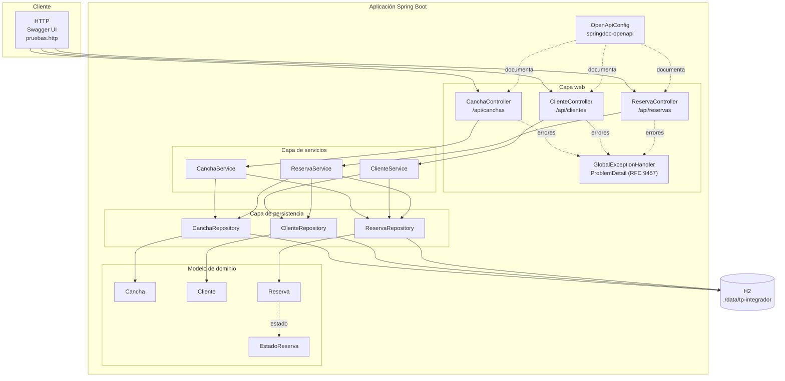
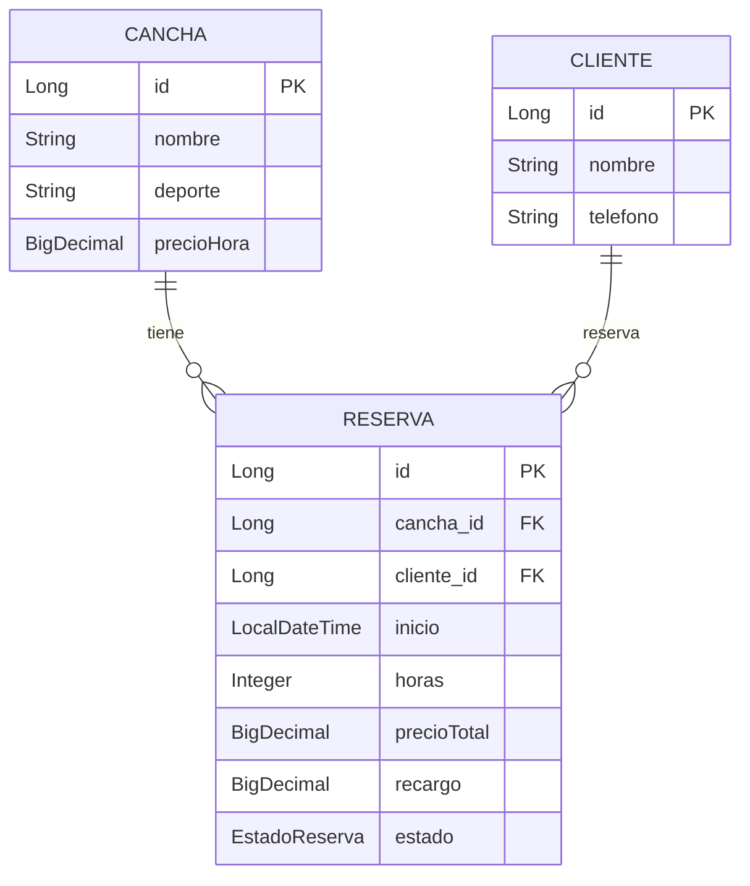
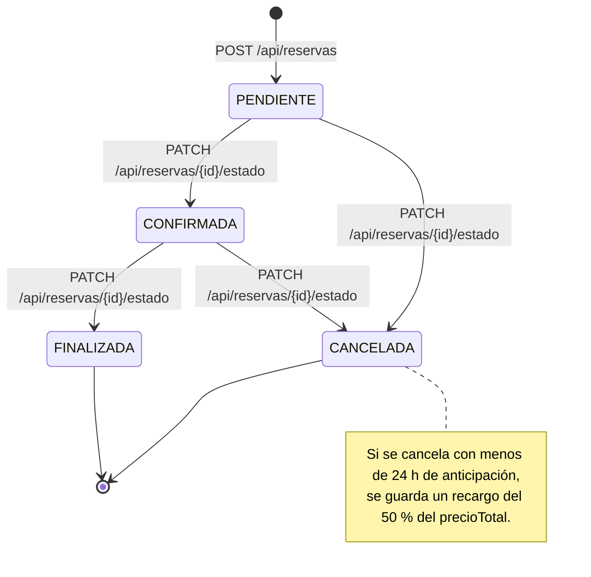
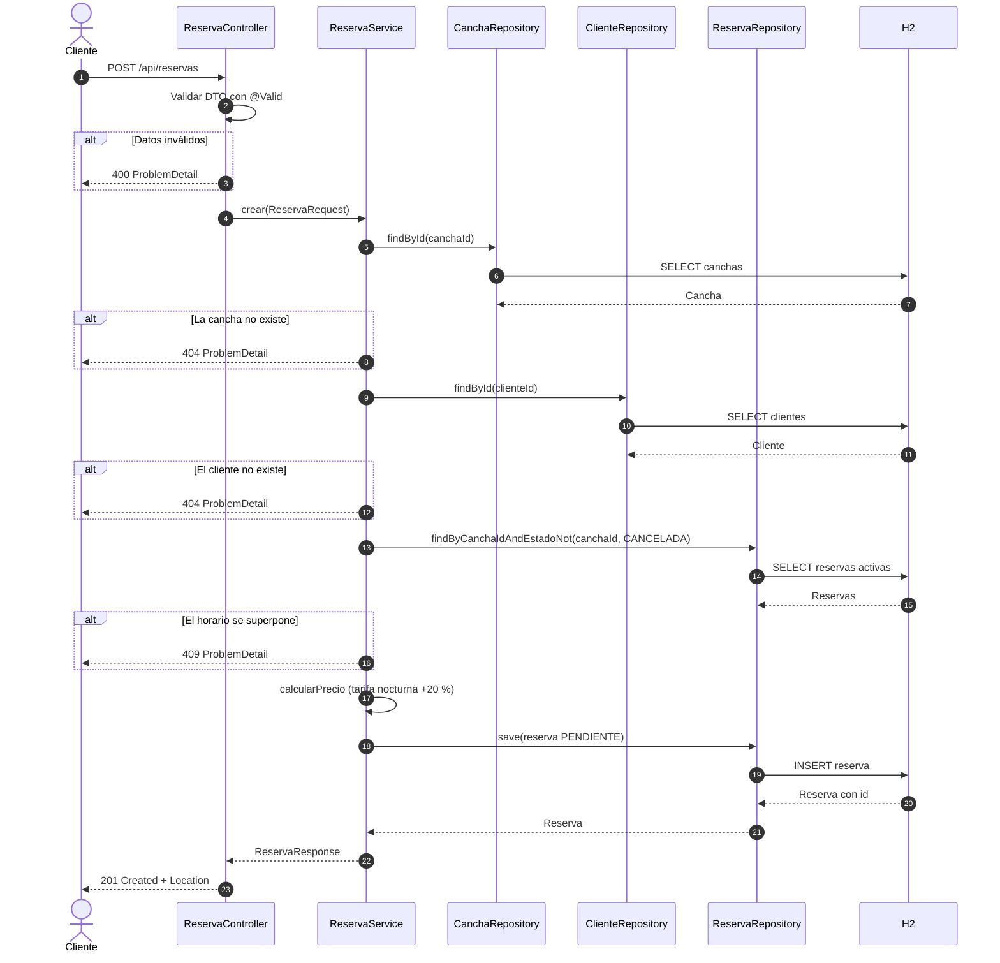

# TP Integrador · DAW1 — Complejo Deportivo

**Alumno: Fabricio Soriano** — · **Legajo: 510114** —
**Enunciado elegido:** canchas

## Descripción

API REST para administrar un complejo de canchas deportivas. Permite cargar canchas, registrar
clientes y tomar reservas por hora, evitando que dos reservas activas se superpongan en la misma
cancha.

## Cómo ejecutarlo

Requisitos: Java 21 (Maven viene incluido con `mvnw`).

```bash
./mvnw spring-boot:run
```

La API queda en `http://localhost:8080/api`. La base H2 se guarda en `data/` (no se sube al
repositorio). Consola H2: `http://localhost:8080/h2-console`.

## Documentación (Swagger / OpenAPI)

La API se documenta automáticamente con springdoc-openapi:

| Recurso | URL |
|---|---|
| Swagger UI | `http://localhost:8080/swagger-ui.html` |
| Contrato OpenAPI (JSON) | `http://localhost:8080/v3/api-docs` |

Desde Swagger UI se pueden probar todos los endpoints sin escribir las peticiones a mano.


## Modelo

| Entidad | Atributos principales | Relaciones |
|---|---|---|
| Cancha | id, nombre, deporte, precioHora | 1 a N con Reserva |
| Cliente | id, nombre, telefono | 1 a N con Reserva |
| Reserva | id, inicio, horas, precioTotal, recargo, estado | N a 1 con Cancha y con Cliente |

Estados de la reserva: `PENDIENTE → CONFIRMADA → FINALIZADA`.
`PENDIENTE` y `CONFIRMADA` también pueden pasar a `CANCELADA`. `FINALIZADA` y `CANCELADA` son
finales.

## Diagramas

Los diagramas siguientes se derivan de las clases y reglas implementadas en `src/main/java`.

### Arquitectura de capas



### Modelo de datos (DER)



`Reserva.estado` es un enum almacenado como texto con los valores `PENDIENTE`, `CONFIRMADA`,
`FINALIZADA` y `CANCELADA`.

### Ciclo de vida de una reserva



Las transiciones no permitidas (saltear estados o volver atrás) se rechazan con `409 Conflict`.

### Flujo de creación de una reserva



## Endpoints

| Método | Ruta | Descripción | Respuestas |
|---|---|---|---|
| GET | /api/canchas | Lista las canchas | 200 |
| GET | /api/canchas/{id} | Busca una cancha por id | 200, 400, 404 |
| POST | /api/canchas | Crea una cancha | 201, 400 |
| PUT | /api/canchas/{id} | Modifica una cancha | 200, 400, 404 |
| DELETE | /api/canchas/{id} | Borra una cancha sin reservas | 204, 404, 409 |
| GET | /api/canchas/{id}/reservas?fecha=AAAA-MM-DD | Reservas de la cancha ese día | 200, 400, 404 |
| GET | /api/canchas/{id}/disponibilidad?fecha=AAAA-MM-DD | Horas libres entre las 08:00 y las 22:00 | 200, 400, 404 |
| GET | /api/canchas/recaudacion?mes=AAAA-MM | Total facturado por cancha con reservas finalizadas | 200, 400 |
| GET | /api/clientes | Lista los clientes | 200 |
| GET | /api/clientes/{id} | Busca un cliente por id | 200, 400, 404 |
| POST | /api/clientes | Crea un cliente | 201, 400 |
| PUT | /api/clientes/{id} | Modifica un cliente | 200, 400, 404 |
| DELETE | /api/clientes/{id} | Borra un cliente sin reservas | 204, 404, 409 |
| GET | /api/clientes/{id}/reservas | Reservas del cliente | 200, 404 |
| GET | /api/reservas | Lista las reservas | 200 |
| GET | /api/reservas/{id} | Busca una reserva por id | 200, 400, 404 |
| POST | /api/reservas | Crea una reserva en estado PENDIENTE | 201, 400, 404, 409 |
| POST | /api/reservas/fijas | Crea la misma reserva N semanas seguidas | 201, 400, 404, 409 |
| PUT | /api/reservas/{id} | Modifica una reserva activa | 200, 400, 404, 409 |
| DELETE | /api/reservas/{id} | Borra una reserva | 204, 404 |
| PATCH | /api/reservas/{id}/estado | Cambia el estado de la reserva | 200, 400, 404, 409 |

Todos los errores se devuelven como `ProblemDetail` y, en los errores de validación, incluyen el
mapa `errores` con el campo y el mensaje.

## Reglas de negocio

1. Dos reservas no canceladas de la misma cancha no pueden superponerse (409). Una reserva que
   empieza justo cuando termina otra es válida.
2. El precio total lo calcula el sistema: `precioHora × horas` (las horas deben ser entre 1 y 3).
3. La reserva se crea siempre en estado `PENDIENTE`; el estado no se recibe en el POST.
4. No se pueden saltear estados ni volver atrás (409).
5. Una cancha o un cliente con reservas asociadas no se pueden borrar (409).
6. Una reserva cancelada libera el horario para una nueva reserva.

## Extras implementados

1. **Horarios libres** — `GET /api/canchas/{id}/disponibilidad?fecha=AAAA-MM-DD` devuelve un
   array de horas (`"08:00"`, `"09:00"`, …) que no se superponen con reservas no canceladas.
2. **Tarifa nocturna** — las horas que empiezan a las 20:00 o después suman un 20 % al
   `precioTotal`.
3. **Turno fijo** — `POST /api/reservas/fijas` con los datos de la reserva más `semanas: N` crea
   N reservas semanales. La operación es todo o nada: si alguna se superpone, devuelve 409 y no
   crea ninguna.
4. **Cancelación tardía** — si se cancela con menos de 24 h de anticipación, la reserva guarda
   `recargo` = 50 % de `precioTotal`; en caso contrario, `recargo` es 0.
5. **Recaudación** — `GET /api/canchas/recaudacion?mes=AAAA-MM` devuelve, por cancha, el total
   facturado con reservas `FINALIZADA` de ese mes.

## Pruebas

En `pruebas.http` están todas las peticiones de ejemplo (se ejecutan desde IntelliJ o desde
cualquier cliente HTTP). La corrección automática se ejecuta con `bash .tp/correr.sh`.
